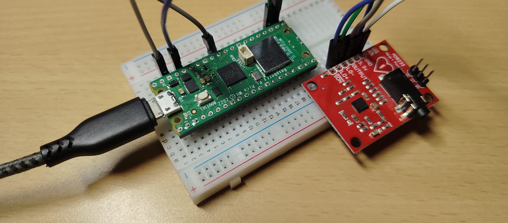
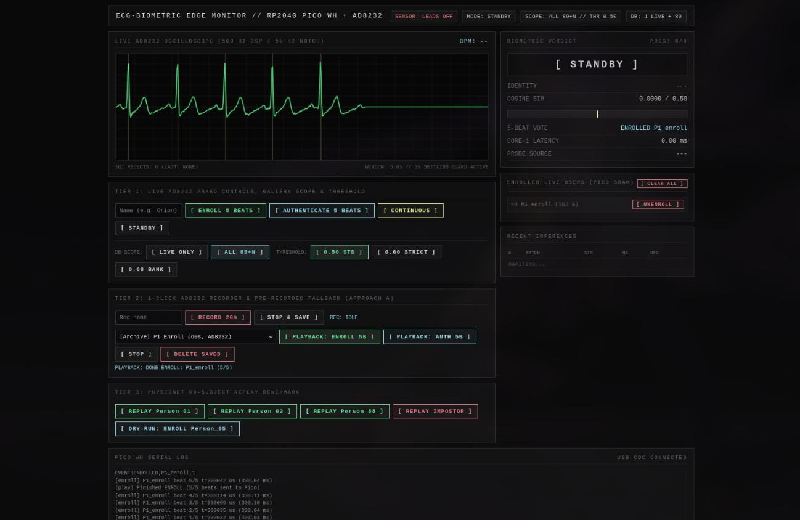

<div align="center">

# hṛdaya

**ECG Biometric Authentication on a Microcontroller**

*Your heartbeat is your password.*

<br>


&nbsp;&nbsp;


<br>

| 90.87% | 4.50% | 300 ms | 14,867 | 0.0000 |
|:---:|:---:|:---:|:---:|:---:|
| single-beat rank-1 | verification EER | on-device inference | parameters | PyTorch vs. C delta |

[Docs](docs/) · [Engineering Journal](docs/JOURNAL.md) · [Hardware Journal](docs/JOURNAL_2.md)

</div>

---

## Overview

hṛdaya is an end-to-end biometric authentication system that identifies a person from a single-lead electrocardiogram. A raw analog heartbeat goes in; an ACCEPT or REJECT verdict comes out. Every step runs on a Raspberry Pi Pico WH (RP2040, dual Cortex-M0+, 264 KB SRAM) wired to an AD8232 analog front-end, with no cloud, server, or ML runtime.

Most ECG biometric work stops at a notebook evaluated on randomly shuffled beats. This project goes further:

- **Leakage-free evaluation.** Each subject's chronologically final recording is held out for testing, so no adjacent beats leak between train and test.
- **A from-scratch inference engine.** The network runs in a zero-dependency ANSI C kernel that matches the PyTorch reference exactly.
- **Real signals.** Live enrollment and authentication were checked on physical silicon against real AD8232 electrode recordings, not only on dataset replay.

---

## Key Features

**Bare-metal neural inference.** `nn_inference.h` implements Conv1D, depthwise-separable convolution, Squeeze-and-Excitation, LayerNorm, and cosine template matching from first principles. It does not use TFLite Micro, CMSIS-NN, or dynamic allocation. Batch norm is fused into the convolution weights at export time. The hardware similarity scores match PyTorch FP32 with a delta of 0.0000.

**Dual-core asymmetric multiprocessing.** Core 1 runs only neural inference and receives jobs over the 32-bit hardware SIO FIFO. Core 0 handles USB CDC serial, LED signaling, the 500 Hz sampling ISR, and an lwIP soft access point that serves a live dashboard at `192.168.4.1`. The UI never blocks during inference.

**On-chip signal processing.** `ecg_dsp.h` provides a causal biquad cascade (0.5–40 Hz band-pass plus a 50 Hz notch), an adaptive R-peak detector, 300-sample z-scored beat windowing, BPM estimation, and a 5-point signal-quality gate. Beats that fail the gate are never sent to the network.

**Zero-shot enrollment.** A new identity is enrolled into SRAM from 5 heartbeats in about 192 bytes per user, with no retraining. The device holds up to 8 live users, and each can be revoked on its own from serial or from the phone dashboard.

**Multi-beat voting.** Authentication combines 5 consecutive beats into one verdict, with selectable security thresholds (0.50 / 0.60 / 0.68) and a choice of gallery scope (live users only, or the full 89-subject gallery).

**Clocked for real time.** Overclocking from 133 MHz to 250 MHz cut per-beat latency from 584 ms to 300 ms, a 48.6% reduction. A beat is processed well within one 833 ms resting cardiac cycle. The 500 Hz sampling ISR adds only 0.16 ms.

---

## Results

### Model comparison

Evaluated on [ECG-ID v1.0.0](https://physionet.org/content/ecgiddb/1.0.0/) (89 subjects, 7,875 segmented beats) with a recording-disjoint split.

| Model | Input | Rank-1 | EER | Size | CPU latency |
|:---|:---|---:|---:|---:|---:|
| AC/DCT + RBF-SVM (baseline) | 32-dim AC/DCT | 79.06% | 13.11% | 480 KB | 1.15 ms |
| LSTM (INT8) | AC/DCT sequence | 49.26% | 10.01% | 76.6 KB | 0.28 ms |
| 1D-CNN (INT8) | raw ECG | 71.37% | 7.32% | 51.9 KB | 0.15 ms |
| **ECG_ResNet_SE (deployed)** | raw ECG | **90.87%** | **4.50%** | **66.3 KB** | **0.62 ms** |
| ECG_ResNet_DualStream | ECG + derivative | 91.08% | 4.93% | 67.9 KB | 0.65 ms |

The deployed model is a compact 1D ResNet with depthwise-separable convolutions and SE channel attention, trained with a hybrid cross-entropy and ArcFace (m = 0.50) loss to produce 48-dimensional embeddings on the unit hypersphere. The dual-stream variant is marginally more accurate but has a worse EER and a larger footprint, so the single-stream model ships.

### Multi-beat decision window

| Beats | Time (~75 BPM) | Rank-1 |
|---:|---:|---:|
| 1 | 0.8 s | 88% |
| 3 | 2.4 s | 95% |
| 5 | 4.0 s | 96% |
| 10 | 8.0 s | 97% |

### Robustness

Full details are in [`results/robustness_report.md`](results/robustness_report.md).

| Test | Result |
|:---|:---|
| All-pairs impostor attack (201,344 pairs) | decidability d' = 4.13, mean impostor similarity -0.003 |
| TAR at FAR = 1% / 0.1% | 93.62% / 88.07% |
| Additive noise at 20 dB SNR | 89.51% rank-1 (-2.3 points from clean) |
| Cross-month subjects (20 subjects) | 95.63% rank-1, no temporal degradation |

### On real hardware

| Scenario | Outcome |
|:---|:---|
| PhysioNet genuine / impostor replay | ACCEPT 0.8346 / REJECT 0.3609, delta 0.0000 vs. PyTorch, 300 ms per beat |
| Live AD8232 user, same electrode placement | 10 / 10 beats correctly identified, similarity up to 0.97 |
| Live AD8232 user, 5-beat vote | ACCEPT, 5 / 5 votes, mean similarity 0.92 |
| Unseen human impostor, 5-beat vote | REJECT, 0 / 5 votes |

---

## Architecture

```text
                 AD8232                         Raspberry Pi Pico WH (RP2040 @ 250 MHz)
            ┌──────────────┐        ┌───────────────────────────────────────────────────┐
 ECG pads ─>│ analog AFE   │──────> │ ADC0 ─> 500 Hz ISR ─> ring buffer                 │
            │ single lead  │        │                                                   │
            └──────────────┘        │ Core 0                        Core 1              │
                                    │  ├─ band-pass + 50 Hz notch    ├─ Conv1D / DW-sep │
                                    │  ├─ R-peak detect, SQI gate    ├─ SE attention    │
                                    │  ├─ USB CDC command channel    ├─ LayerNorm       │
                                    │  ├─ Wi-Fi AP + HTTP dashboard  ├─ 48-d embedding  │
                                    │  └─ LED signaling              └─ cosine match    │
                                    │          │      SIO FIFO       ▲     │            │
                                    │          └─────────────────────┘     │            │
                                    │                                5-beat vote        │
                                    └──────────────────────────────────────┼────────────┘
                                                                           ▼
                                                                    ACCEPT / REJECT
```

**Footprint.** The firmware image is 824 KB of flash, including the CYW43439 Wi-Fi and lwIP stacks. Runtime SRAM use is about 104 KB, with a peak activation double buffer of about 12 KB.

---

## Getting Started

### Requirements

- Python 3.12 and [uv](https://docs.astral.sh/uv/)
- For hardware: Raspberry Pi Pico WH, AD8232 module, gel electrodes, and the Pico SDK with an ARM GCC toolchain

### Train and evaluate

```bash
make setup         # install locked dependencies
make data          # download ECG-ID (~13 MB)
make features      # extract 300-sample cardiac cycles (recording-disjoint split)
make champion      # train ECG_ResNet_SE with hybrid CE + ArcFace loss
make robustness    # noise, impostor, HRV, and longitudinal stress tests
make ablation      # multi-beat voting ablation
make demo          # offline ACCEPT / REJECT replay
make test          # unit and integration tests
```

### Deploy to the Pico

Wire the AD8232 `OUTPUT` to `GP26 / ADC0`, connect `LO+` to `GP16` and `LO-` to `GP17` for lead-off detection, and power it from 3.3 V and GND. Then:

```bash
uv run python hardware/scripts/pico_deploy.py all                          # build, flash, and self-test
uv run python hardware/scripts/pico_deploy.py stream --subject Person_01   # genuine identity
uv run python hardware/scripts/pico_deploy.py stream --impostor            # impostor rejection
uv run python hardware/scripts/pico_deploy.py monitor                      # live oscilloscope at localhost:8080
```

Join the Pico's access point (SSID `pico`, password `picosama`) and open `http://192.168.4.1` for the live waveform, voting status, and enrollment controls.

---

## Repository Layout

```text
hrdaya/
├── src/mlee/            PyTorch models, ArcFace loss, dataset and augmentation, trainers
├── hardware/
│   ├── firmware/        ANSI C firmware: nn_inference.h, ecg_dsp.h, main.c, wifi_server.c
│   └── scripts/         deploy CLI, BN-fusing C weight exporter, serial test runner, live monitor
├── configs/             experiment configurations
├── scripts/             feature extraction, benchmarks, ablation, demo replay, figures
├── results/             timestamped metrics with full run provenance
├── tests/               pipeline and invariant tests
└── docs/                report, poster, engineering journals, demo playbook, theory notes
```

---

## Limitations

- Accuracy drops sharply below 15 dB SNR and with heart-rate shifts beyond about ±10%, because the beat window has a fixed length. Multi-beat voting reduces but does not remove this effect.
- When electrodes are re-placed between sessions or the signal is noisy, open-set matching against the full 89-subject gallery can produce false matches. Restricting the search to the live gallery with a 0.68 threshold fixed this in testing.
- The live-electrode validation covers a small number of people and is not a population-scale study.

---

## License and Acknowledgements

The code is released under the [MIT License](LICENSE).

This project uses the [ECG-ID Database v1.0.0](https://physionet.org/content/ecgiddb/1.0.0/) by Tatiana Lugovaya, distributed through PhysioNet under the Open Data Commons Attribution License (ODC-By 1.0).
